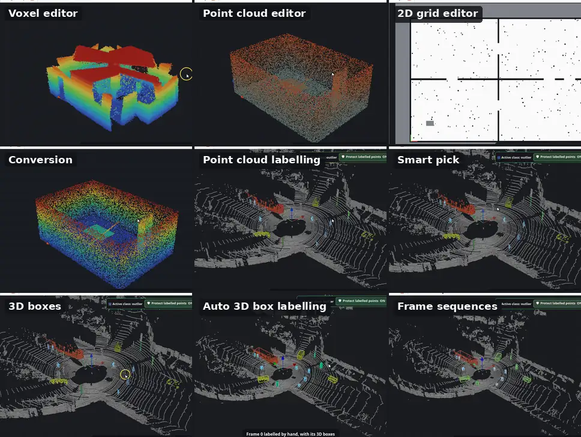
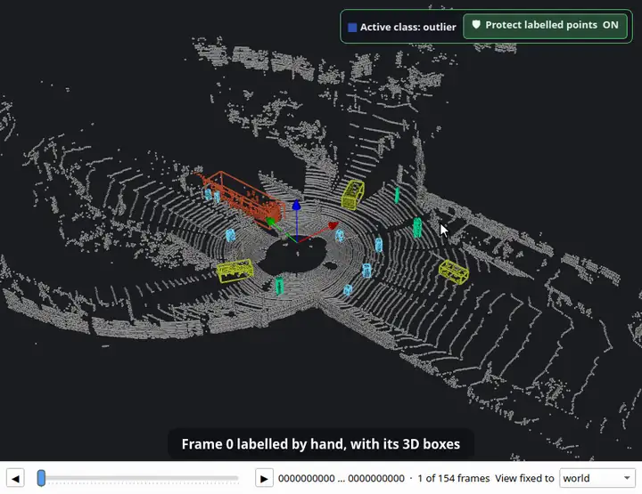

<p align="center">
  <picture>
    <source media="(prefers-color-scheme: dark)" srcset="docs/logo-dark.svg">
    
  </picture>
</p>

<p align="center">
  <a href="README.md">English</a> · <a href="README.ko.md">한국어</a> · <a href="README.ja.md">日本語</a> · <a href="README.zh.md">简体中文</a> · <b>Deutsch</b> · <a href="README.es.md">Español</a>
</p>

**Ein Friseursalon für Roboterkarten.** Bereinigen und bearbeiten Sie OctoMap-Voxelkarten, Punktwolken und ROS-2D-Belegungsraster — und seit 1.1 auch LiDAR-Punktwolken und Scan-Sequenzen beschriften. Alles läuft offline in einem Fenster.

[](https://github.com/Hyounjun-Oh/MapBarber/actions/workflows/tests.yml)




<sub>Beschriftungs-Animationen: [KITTI raw dataset](https://www.cvlibs.net/datasets/kitti/raw_data.php), Fahrt 2011_09_26_0005 (Geiger et al., CC BY-NC-SA 3.0), Frame 0 von Hand beschriftet.</sub>

Ausführliche Anleitung, alle Tastenkürzel und die Hinweise zu Dateien stehen im **[Wiki](https://github.com/Hyounjun-Oh/MapBarber/wiki)**.

## Funktionen

- **Voxel-Editor** — OctoMap `.bt` / `.ot`: radieren, hinzufügen, schwebende Inseln, Quader, Schnitt, Lineal; 35 Millionen Voxel bleiben flüssig.
- **Punktwolken-Editor** — PCD, PLY, LAS/LAZ, Text, `.bin`: Rauschfilter, Ausdünnen, Färben nach jedem Feld; beim Speichern bleibt jedes Feld erhalten.
- **2D-Raster-Editor** — ROS-map_server-Karten: Stift, Linie, Rechteck, Füllen, Sprenkel, Rand zuschneiden, Ursprung.
- **Umwandlung** — Voxelkarte ↔ Punktwolke ↔ 2D-Raster, verlustfrei hin und zurück.
- **LiDAR-Beschriftung** — Klassen, intelligente Auswahl, 3D-Quader und automatische 3D-Quader-Beschriftung über Scan-Sequenzen; Export nach SemanticKITTI, KITTI und OpenPCDet.
- **Kommandozeile** — Stapelbereinigung und Umwandlung ohne Fenster.

| Voxelkarten | Punktwolken | 2D-Belegungsraster |
|---|---|---|
|  |  |  |

Karten lassen sich verlustfrei zwischen den drei Arten umwandeln, und jede Bearbeitung ist bis zum Speichern rückgängig zu machen.

## Schnellstart

```bash
git clone https://github.com/Hyounjun-Oh/MapBarber.git
cd MapBarber
./mapbarber.sh                                  # leeres Fenster — Karten hineinziehen
./mapbarber.sh demo/office_octomap.bt           # oder Dateien öffnen, je ein Tab
```

Der erste Start installiert NumPy, SciPy, VTK und PySide6 in `.venv/` (etwa 500 MB); nötig sind Python 3.10+ und eine Desktop-Sitzung. `pip install .` geht auch (`pip install ".[las]"` ergänzt LAS/LAZ). [`demo/`](demo/README.md) enthält realistische Karten mit bekannten Fehlern und eine Checkliste.

## Neu in 1.1: LiDAR-Beschriftung

### Punktwolken beschriften
Klassen, Beschriftungspinsel, Schutz beschrifteter Punkte, Prüfwerkzeuge, Objekte und Export nach SemanticKITTI, KITTI und OpenPCDet.


### Intelligente Auswahl
Ein Klick nimmt ein ganzes Auto, einen Fußgänger oder einen Mast ohne den Boden darunter — oder eine ganze Ebene.


### 3D-Quader
Eine Klasse in Objekte teilen und jedes mit einem Quader versehen; wenige falsch beschriftete Punkte dehnen keinen Quader.


### Automatische 3D-Quader-Beschriftung
Quader und Punktlabels werden vorwärts oder rückwärts in der Zeit durch eine ganze Fahrt weitergetragen. Hier: von einem von Hand beschrifteten Frame durch alle 154 Scans.



<sub>Beschriftungs-Animationen: [KITTI raw dataset](https://www.cvlibs.net/datasets/kitti/raw_data.php), Fahrt 2011_09_26_0005 (Geiger et al., CC BY-NC-SA 3.0), Frame 0 von Hand beschriftet.</sub>

## Dokumentation

Die vollständige Anleitung steht im **[Wiki](https://github.com/Hyounjun-Oh/MapBarber/wiki)** (Englisch, Koreanisch): [Erste Schritte](https://github.com/Hyounjun-Oh/MapBarber/wiki/Getting-Started) · [Beschriften](https://github.com/Hyounjun-Oh/MapBarber/wiki/Labelling) · [Intelligente Auswahl](https://github.com/Hyounjun-Oh/MapBarber/wiki/Smart-Pick) · [3D-Quader](https://github.com/Hyounjun-Oh/MapBarber/wiki/3D-Boxes) · [3D-Quader-Beschriftung](https://github.com/Hyounjun-Oh/MapBarber/wiki/Auto-3D-Box-Labelling) · [Frame-Sequenzen](https://github.com/Hyounjun-Oh/MapBarber/wiki/Frame-Sequences) · [Tastenkürzel](https://github.com/Hyounjun-Oh/MapBarber/wiki/Keyboard-Shortcuts) · [Dateien und Formate](https://github.com/Hyounjun-Oh/MapBarber/wiki/Files-and-Formats) · [Kommandozeile](https://github.com/Hyounjun-Oh/MapBarber/wiki/Command-Line) · [FAQ](https://github.com/Hyounjun-Oh/MapBarber/wiki/FAQ)

## Lizenz

[MIT](LICENSE) — frei nutzbar, änderbar und weitergebbar, auch kommerziell. Abhängigkeiten behalten ihre eigenen Lizenzen (PySide6 LGPL-3.0; VTK, NumPy, SciPy BSD-3-Clause); siehe [THIRD_PARTY_NOTICES.md](THIRD_PARTY_NOTICES.md), auch zu den KITTI-Daten in den Beschriftungs-Animationen. [Änderungen](CHANGELOG.md) · [Mitwirken](CONTRIBUTING.md) · [Sicherheit](SECURITY.md)
