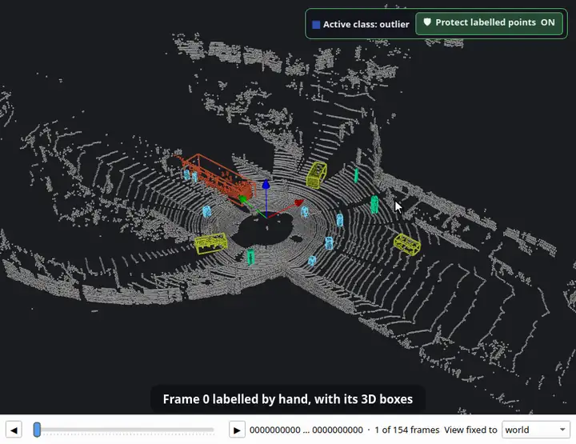

<p align="center">
  <picture>
    <source media="(prefers-color-scheme: dark)" srcset="docs/logo-dark.svg">
    
  </picture>
</p>

<p align="center">
  <a href="README.md">English</a> · <a href="README.ko.md">한국어</a> · <a href="README.ja.md">日本語</a> · <a href="README.zh.md">简体中文</a> · <a href="README.de.md">Deutsch</a> · <b>Español</b>
</p>

**Una barbería para mapas de robots.** Limpia y edita mapas de vóxeles OctoMap, nubes de puntos y rejillas de ocupación 2D de ROS — y, desde la 1.1, etiqueta nubes de puntos LiDAR y secuencias de escaneos. Todo funciona sin conexión, en una sola ventana.

[](https://github.com/Hyounjun-Oh/MapBarber/actions/workflows/tests.yml)


## Novedad en 1.1: etiquetado LiDAR

### Etiquetado de nubes de puntos
Clases, pincel de etiquetas, protección de puntos etiquetados, herramientas de revisión, objetos y exportación a SemanticKITTI, KITTI y OpenPCDet.


### Selección inteligente
Un clic toma un coche, un peatón o un poste entero sin el suelo de debajo — o un plano entero.


### Cajas 3D
Divide una clase en objetos y pon una caja a cada uno; unos pocos puntos mal etiquetados no estiran la caja.


### Seguimiento automático de cajas 3D
Sigue las cajas hacia delante o hacia atrás en el tiempo a lo largo de todo un trayecto. Aquí: desde un fotograma etiquetado a mano por los 154 escaneos.



<sub>Animaciones de etiquetado: [KITTI raw dataset](https://www.cvlibs.net/datasets/kitti/raw_data.php), trayecto 2011_09_26_0005 (Geiger et al., CC BY-NC-SA 3.0), fotograma 0 etiquetado a mano.</sub>

## Editores

| Mapas de vóxeles | Nubes de puntos | Rejillas de ocupación 2D |
|---|---|---|
|  |  |  |
| OctoMap `.bt` / `.ot`: borrar, añadir, islas, caja, corte, regla | PCD, PLY, LAS/LAZ, texto, `.bin`: filtros de ruido, aclarado, color por campo | YAML de map_server + PGM/PNG: lápiz, línea, relleno, motas, recorte del borde |

Los mapas se convierten entre los tres tipos sin pérdidas, y toda edición se puede deshacer hasta guardar.

## Inicio rápido

```bash
git clone https://github.com/Hyounjun-Oh/MapBarber.git
cd MapBarber
./mapbarber.sh                                  # ventana vacía — suelta mapas en ella
./mapbarber.sh demo/office_octomap.bt           # o abre archivos, una pestaña cada uno
```

La primera ejecución instala NumPy, SciPy, VTK y PySide6 en `.venv/` (unos 500 MB); hace falta Python 3.10+ y una sesión de escritorio. También funciona `pip install .` (`pip install ".[las]"` añade LAS/LAZ). [`demo/`](demo/README.md) tiene mapas realistas con defectos conocidos y una lista de comprobación.

## Documentación

La guía completa está en la **[wiki](https://github.com/Hyounjun-Oh/MapBarber/wiki)** (inglés, coreano): [Primeros pasos](https://github.com/Hyounjun-Oh/MapBarber/wiki/Getting-Started) · [Etiquetado](https://github.com/Hyounjun-Oh/MapBarber/wiki/Labelling) · [Selección inteligente](https://github.com/Hyounjun-Oh/MapBarber/wiki/Smart-Pick) · [Cajas 3D](https://github.com/Hyounjun-Oh/MapBarber/wiki/3D-Boxes) · [Seguimiento de cajas 3D](https://github.com/Hyounjun-Oh/MapBarber/wiki/Auto-3D-Box-Tracking) · [Secuencias](https://github.com/Hyounjun-Oh/MapBarber/wiki/Frame-Sequences) · [Atajos de teclado](https://github.com/Hyounjun-Oh/MapBarber/wiki/Keyboard-Shortcuts) · [Archivos y formatos](https://github.com/Hyounjun-Oh/MapBarber/wiki/Files-and-Formats) · [Línea de comandos](https://github.com/Hyounjun-Oh/MapBarber/wiki/Command-Line) · [FAQ](https://github.com/Hyounjun-Oh/MapBarber/wiki/FAQ)

## Licencia

[MIT](LICENSE) — libre de usar, modificar y redistribuir, también comercialmente. Las dependencias mantienen sus propias licencias (PySide6 LGPL-3.0; VTK, NumPy, SciPy BSD-3-Clause); consulta [THIRD_PARTY_NOTICES.md](THIRD_PARTY_NOTICES.md), que cubre también los datos de KITTI de las animaciones de etiquetado. [Cambios](CHANGELOG.md) · [Contribuir](CONTRIBUTING.md) · [Seguridad](SECURITY.md)
