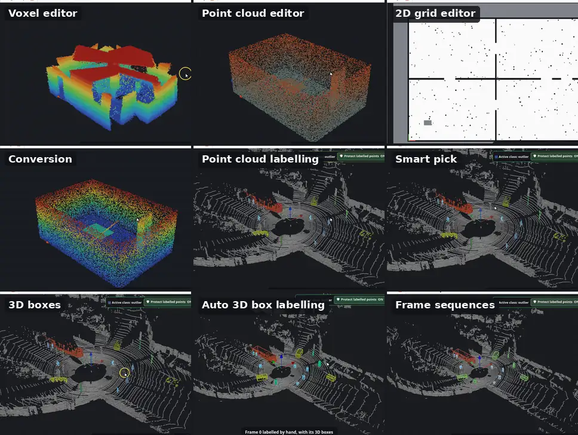
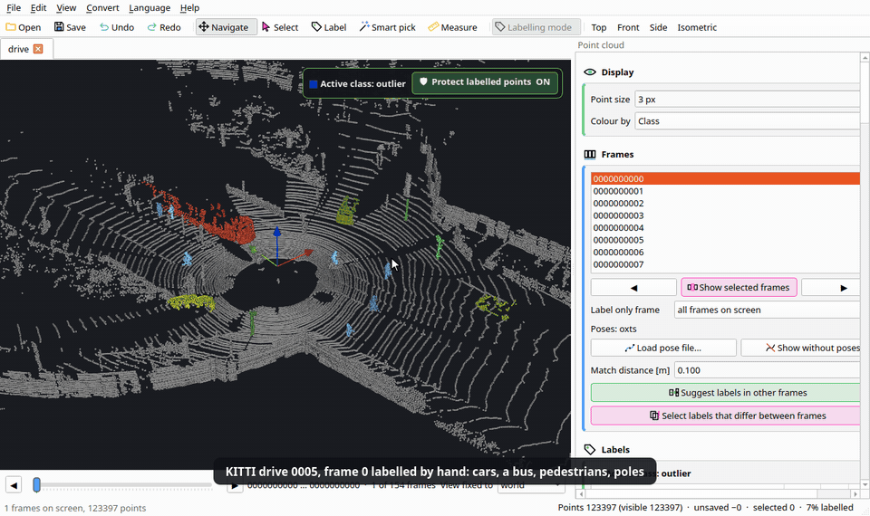
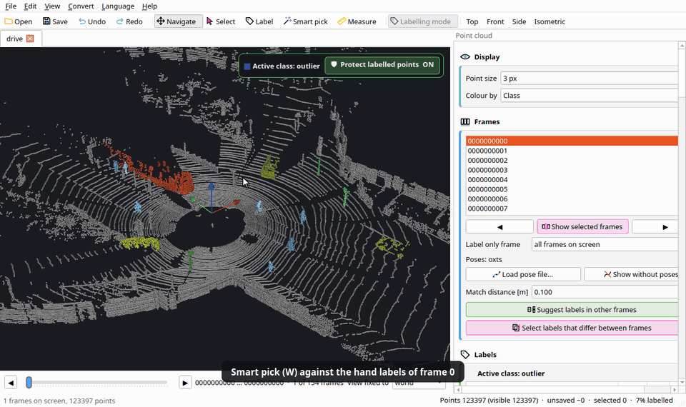
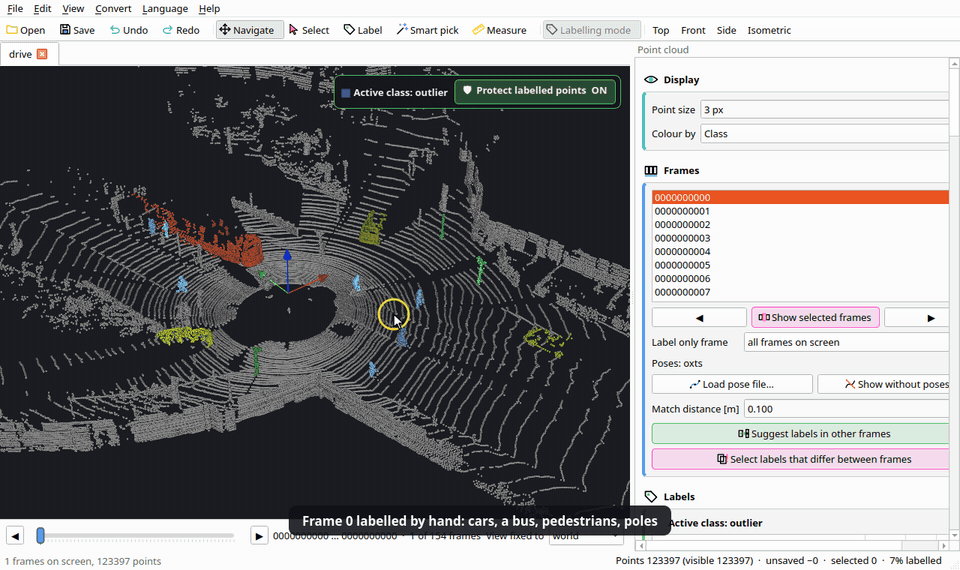
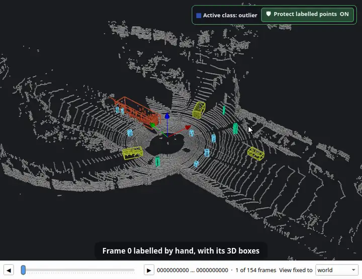

<p align="center">
  <picture>
    <source media="(prefers-color-scheme: dark)" srcset="docs/logo-dark.svg">
    
  </picture>
</p>

<p align="center">
  <a href="README.md">English</a> · <a href="README.ko.md">한국어</a> · <b>日本語</b> · <a href="README.zh.md">简体中文</a> · <a href="README.de.md">Deutsch</a> · <a href="README.es.md">Español</a>
</p>

**ロボット地図の床屋。** OctoMap のボクセル地図、点群、ROS の 2D 占有格子を整え、編集します。1.1 からは LiDAR 点群とスキャン列のラベル付けもできます。すべてオフライン、ひとつのウィンドウで動きます。

[](https://github.com/Hyounjun-Oh/MapBarber/actions/workflows/tests.yml)




<sub>ラベル付けのアニメーション: [KITTI raw dataset](https://www.cvlibs.net/datasets/kitti/raw_data.php)、走行 2011_09_26_0005 (Geiger et al., CC BY-NC-SA 3.0)、フレーム 0 は手でラベル付け。</sub>

詳しい使い方、すべてのショートカット、ファイルの注意点は **[Wiki](https://github.com/Hyounjun-Oh/MapBarber/wiki)** にあります。

## 機能

- **ボクセルエディタ** — OctoMap `.bt` / `.ot`: 消去、追加、浮いた孤立クラスタ、ボックス、スライス、定規。3,500 万ボクセルでも操作できます。
- **点群エディタ** — PCD, PLY, LAS/LAZ, テキスト, `.bin`: ノイズフィルタ、間引き、フィールド別の色。保存してもすべてのフィールドが残ります。
- **2D 格子エディタ** — ROS map_server の地図: ペン、直線、四角形、塗りつぶし、ごみ取り、余白の切り取り、原点。
- **変換** — ボクセル地図 ↔ 点群 ↔ 2D 格子、劣化のない往復変換。
- **LiDAR ラベル付け** — クラス、スマート選択、3D ボックス、スキャン列全体の自動 3D ボックスラベル付け。SemanticKITTI・KITTI・OpenPCDet 形式へ書き出し。
- **コマンドライン** — ウィンドウなしで一括整理・変換。

| ボクセル地図 | 点群 | 2D 占有格子 |
|---|---|---|
|  |  |  |

3 種類の間を劣化なしで変換でき、保存するまですべての編集を元に戻せます。

## クイックスタート

```bash
git clone https://github.com/Hyounjun-Oh/MapBarber.git
cd MapBarber
./mapbarber.sh                                  # 空のウィンドウ — 地図をドロップ
./mapbarber.sh demo/office_octomap.bt           # またはファイルを開く (ファイルごとにタブ)
```

初回起動で `.venv/` に NumPy、SciPy、VTK、PySide6 を入れます (約 500 MB)。Python 3.10 以上とデスクトップ環境が必要です。`pip install .` でも使え、`pip install ".[las]"` で LAS/LAZ に対応します。[`demo/`](demo/README.md) に欠陥のわかっている地図とチェックリストがあります。

## 1.1 の新機能: LiDAR ラベル付け

### 点群のラベル付け
クラス、ラベルブラシ、ラベル済み点の保護、確認ツール、物体、SemanticKITTI・KITTI・OpenPCDet 形式への書き出し。



### スマート選択
クリックひとつで車・歩行者・ポールを地面なしで、あるいは平面全体を選択します。



### 3D バウンディングボックス
クラスを物体に分けて物体ごとにボックスを作ります。少数の誤ラベル点でボックスが伸びません。



### 自動 3D ボックスラベル付け
ボックスと点のラベルを時間順・逆順に走行全体へ引き継ぎます。例: 手でラベル付けした 1 フレームから 154 スキャン全体へ。



<sub>ラベル付けのアニメーション: [KITTI raw dataset](https://www.cvlibs.net/datasets/kitti/raw_data.php)、走行 2011_09_26_0005 (Geiger et al., CC BY-NC-SA 3.0)、フレーム 0 は手でラベル付け。</sub>

## ドキュメント

詳しい使い方は **[Wiki](https://github.com/Hyounjun-Oh/MapBarber/wiki)** (英語・韓国語) にあります: [はじめに](https://github.com/Hyounjun-Oh/MapBarber/wiki/Getting-Started) · [ラベル付け](https://github.com/Hyounjun-Oh/MapBarber/wiki/Labelling) · [スマート選択](https://github.com/Hyounjun-Oh/MapBarber/wiki/Smart-Pick) · [3D ボックス](https://github.com/Hyounjun-Oh/MapBarber/wiki/3D-Boxes) · [自動 3D ボックスラベル付け](https://github.com/Hyounjun-Oh/MapBarber/wiki/Auto-3D-Box-Labelling) · [フレーム列](https://github.com/Hyounjun-Oh/MapBarber/wiki/Frame-Sequences) · [ショートカット](https://github.com/Hyounjun-Oh/MapBarber/wiki/Keyboard-Shortcuts) · [ファイル形式](https://github.com/Hyounjun-Oh/MapBarber/wiki/Files-and-Formats) · [コマンドライン](https://github.com/Hyounjun-Oh/MapBarber/wiki/Command-Line) · [FAQ](https://github.com/Hyounjun-Oh/MapBarber/wiki/FAQ)

## ライセンス

[MIT](LICENSE) — 商用を含め自由に使用・改変・再配布できます。依存ライブラリはそれぞれのライセンスに従います (PySide6 LGPL-3.0、VTK・NumPy・SciPy BSD-3-Clause)。ラベル付けのアニメーションに使った KITTI データも含め [THIRD_PARTY_NOTICES.md](THIRD_PARTY_NOTICES.md) をご覧ください。[変更履歴](CHANGELOG.md) · [貢献](CONTRIBUTING.md) · [セキュリティ](SECURITY.md)
