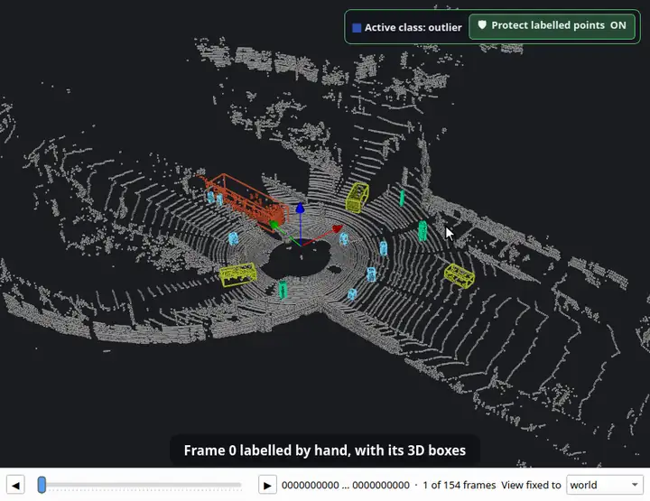

<p align="center">
  <picture>
    <source media="(prefers-color-scheme: dark)" srcset="docs/logo-dark.svg">
    
  </picture>
</p>

<p align="center">
  <a href="README.md">English</a> · <b>한국어</b> · <a href="README.ja.md">日本語</a> · <a href="README.zh.md">简体中文</a> · <a href="README.de.md">Deutsch</a> · <a href="README.es.md">Español</a>
</p>

**로봇 맵을 위한 이발소.** OctoMap 복셀 맵, 포인트 클라우드, ROS 2D 점유 격자를 정리하고 편집합니다. 1.1 부터는 LiDAR 포인트 클라우드와 스캔 시퀀스 라벨링도 됩니다. 모두 오프라인으로, 창 하나에서 동작합니다.

[](https://github.com/Hyounjun-Oh/MapBarber/actions/workflows/tests.yml)


## 1.1 신규: LiDAR 라벨링

### 포인트 클라우드 라벨링
클래스, 라벨 붓, 라벨된 포인트 보호, 검수 도구, 물체, 그리고 SemanticKITTI·KITTI·OpenPCDet 형식 내보내기.


### 스마트 선택
클릭 한 번에 차·보행자·기둥을 바닥 없이, 또는 평면 전체를 선택합니다.


### 3D 바운딩 박스
클래스를 물체로 나누고 물체마다 박스를 만듭니다. 잘못 라벨된 소수의 점이 박스를 늘리지 않습니다.


### 자동 3D 박스 추적
박스를 시간순·역순으로 주행 전체에 걸쳐 따라갑니다. 예시: 직접 라벨링한 프레임 하나에서 154개 스캔 전체로 추적.



<sub>라벨링 애니메이션: [KITTI raw dataset](https://www.cvlibs.net/datasets/kitti/raw_data.php), 2011_09_26_0005 주행 (Geiger et al., CC BY-NC-SA 3.0), 0번 프레임은 직접 라벨링한 GT.</sub>

## 편집기

| 복셀 맵 | 포인트 클라우드 | 2D 점유 격자 |
|---|---|---|
|  |  |  |
| OctoMap `.bt` / `.ot`: 지우기, 추가, 고립 덩어리, 상자, 슬라이스, 자 | PCD, PLY, LAS/LAZ, 텍스트, `.bin`: 잡음 필터, 솎아내기, 필드별 색 | map_server YAML + PGM/PNG: 펜, 직선, 채우기, 잡티, 테두리 자르기 |

세 종류 사이를 손실 없이 변환하고, 저장하기 전까지 모든 편집을 되돌릴 수 있습니다.

## 빠른 시작

```bash
git clone https://github.com/Hyounjun-Oh/MapBarber.git
cd MapBarber
./mapbarber.sh                                  # 빈 창 — 맵 파일을 끌어다 놓으세요
./mapbarber.sh demo/office_octomap.bt           # 또는 파일을 바로 열기 (파일마다 탭 하나)
```

처음 실행할 때 `.venv/` 에 NumPy, SciPy, VTK, PySide6 를 설치합니다(약 500 MB). Python 3.10 이상과 데스크톱 환경이 필요합니다. `pip install .` 도 되고, `pip install ".[las]"` 는 LAS/LAZ 지원을 더합니다. [`demo/`](demo/README.ko.md) 에 결함을 아는 실제 같은 맵과 점검표가 있습니다.

## 문서

자세한 사용법은 **[위키](https://github.com/Hyounjun-Oh/MapBarber/wiki/Home-ko)** 에 있습니다: [시작하기](https://github.com/Hyounjun-Oh/MapBarber/wiki/Getting-Started-ko) · [라벨링](https://github.com/Hyounjun-Oh/MapBarber/wiki/Labelling-ko) · [스마트 선택](https://github.com/Hyounjun-Oh/MapBarber/wiki/Smart-Pick-ko) · [3D 박스](https://github.com/Hyounjun-Oh/MapBarber/wiki/3D-Boxes-ko) · [자동 3D 박스 추적](https://github.com/Hyounjun-Oh/MapBarber/wiki/Auto-3D-Box-Tracking-ko) · [프레임 시퀀스](https://github.com/Hyounjun-Oh/MapBarber/wiki/Frame-Sequences-ko) · [단축키](https://github.com/Hyounjun-Oh/MapBarber/wiki/Keyboard-Shortcuts-ko) · [파일 형식](https://github.com/Hyounjun-Oh/MapBarber/wiki/Files-and-Formats-ko) · [명령행](https://github.com/Hyounjun-Oh/MapBarber/wiki/Command-Line-ko) · [FAQ](https://github.com/Hyounjun-Oh/MapBarber/wiki/FAQ-ko) — [English](https://github.com/Hyounjun-Oh/MapBarber/wiki) 판도 있습니다.

## 라이선스

[MIT](LICENSE) — 상업적 용도를 포함해 자유롭게 사용·수정·재배포할 수 있습니다. 의존 라이브러리는 각자의 라이선스를 따릅니다(PySide6 LGPL-3.0, VTK·NumPy·SciPy BSD-3-Clause). 라벨링 애니메이션에 쓴 KITTI 데이터를 포함해 [THIRD_PARTY_NOTICES.md](THIRD_PARTY_NOTICES.md) 를 보세요. [변경 내역](CHANGELOG.md) · [기여](CONTRIBUTING.md) · [보안](SECURITY.md)
