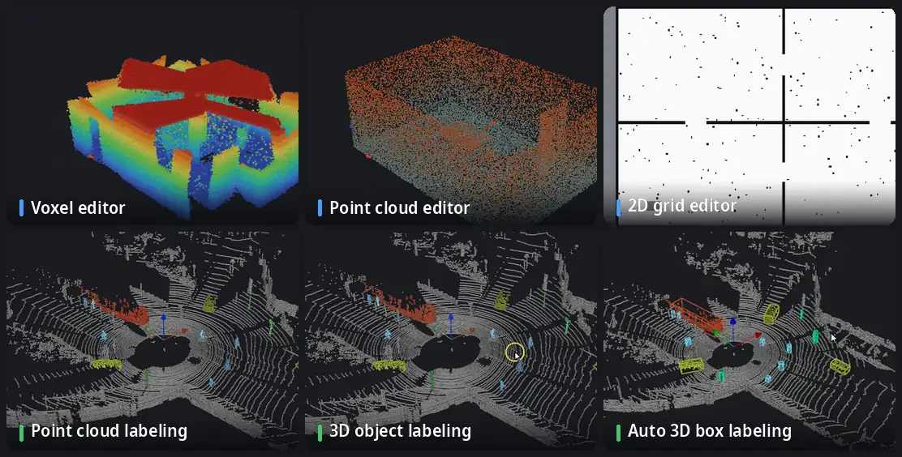

<p align="center">
  <picture>
    <source media="(prefers-color-scheme: dark)" srcset="docs/media/logo-dark.svg">
    
  </picture>
</p>

<p align="center">
  <b>English</b> · <a href="docs/i18n/README.ko.md">한국어</a> · <a href="docs/i18n/README.ja.md">日本語</a> · <a href="docs/i18n/README.zh.md">简体中文</a> · <a href="docs/i18n/README.de.md">Deutsch</a> · <a href="docs/i18n/README.es.md">Español</a>
</p>

**A barbershop for robot maps.** Clean and edit OctoMap voxel maps, point clouds and ROS 2D occupancy grids — and, since 1.1, label point clouds and LiDAR scan sequences. Everything runs offline, in one window.

[](https://github.com/Hyounjun-Oh/MapBarber/actions/workflows/tests.yml)


## Features



<sub>LiDAR scenes: [KITTI raw dataset](https://www.cvlibs.net/datasets/kitti/raw_data.php), drive 2011_09_26_0005 (Geiger et al., CC BY-NC-SA 3.0), frame 0 labeled by hand.</sub>

- **Voxel editor** — OctoMap `.bt` / `.ot`: erase, add, floating islands, box, slice, ruler; 35 million voxels stay interactive.
- **Point cloud editor** — PCD, PLY, LAS/LAZ, text, `.bin`: noise filters, thinning, colour by any field; every field is kept on save.
- **2D grid editor** — ROS map_server maps: pen, line, rectangle, fill, speckles, border trim, origin.
- **Point cloud labeling** — classes, label brush, smart pick (one click per object, plane or surface), protection of labeled points, review tools.
- **3D object labeling** — split a class into objects and give each an upright 3D box; a few mislabeled points do not stretch a box.
- **Auto 3D box labeling** — boxes and point labels carried forwards or backwards in time through a scan sequence.

Also: lossless **conversion** between the three map types, **benchmark export** (SemanticKITTI, KITTI object and tracking, OpenPCDet) and a **command line** for batch work.

Detailed usage, every shortcut and the file notes are in the **[wiki](https://github.com/Hyounjun-Oh/MapBarber/wiki)**.

## Quick start

```bash
git clone https://github.com/Hyounjun-Oh/MapBarber.git
cd MapBarber
./mapbarber.sh                                  # empty window — drop maps onto it
./mapbarber.sh demo/office_octomap.bt           # or open files, one tab each
```

The first run installs NumPy, SciPy, VTK and PySide6 into `.venv/` (about 500 MB); you need Python 3.10+ and a desktop session. `pip install .` works too (`pip install ".[las]"` adds LAS/LAZ). [`demo/`](demo/README.md) has realistic maps with known defects and a checklist.

## New in 1.1

- **Point cloud labeling** for single clouds, scan sequences and voxel maps
- **Smart pick**: a whole car, pedestrian or pole without the ground, or a whole plane, with one click
- **3D object labeling** with robust box fitting
- **Auto 3D box labeling** forwards or backwards in time
- **Frame sequences**: KITTI and pose folders, a timeline, labels carried between frames
- **Benchmark export**: SemanticKITTI, KITTI object and tracking, OpenPCDet

Everything in the [changelog](docs/CHANGELOG.md).

## Documentation

The **[wiki](https://github.com/Hyounjun-Oh/MapBarber/wiki)** is the full guide: [Getting started](https://github.com/Hyounjun-Oh/MapBarber/wiki/Getting-Started) · [Point cloud labeling](https://github.com/Hyounjun-Oh/MapBarber/wiki/Labeling) · [Smart pick](https://github.com/Hyounjun-Oh/MapBarber/wiki/Smart-Pick) · [3D object labeling](https://github.com/Hyounjun-Oh/MapBarber/wiki/3D-Boxes) · [Auto 3D box labeling](https://github.com/Hyounjun-Oh/MapBarber/wiki/Auto-3D-Box-Labeling) · [Benchmark export](https://github.com/Hyounjun-Oh/MapBarber/wiki/Benchmark-Export) · [Frame sequences](https://github.com/Hyounjun-Oh/MapBarber/wiki/Frame-Sequences) · [Keyboard shortcuts](https://github.com/Hyounjun-Oh/MapBarber/wiki/Keyboard-Shortcuts) · [Files and formats](https://github.com/Hyounjun-Oh/MapBarber/wiki/Files-and-Formats) · [Command line](https://github.com/Hyounjun-Oh/MapBarber/wiki/Command-Line) · [FAQ](https://github.com/Hyounjun-Oh/MapBarber/wiki/FAQ) — also in [한국어](https://github.com/Hyounjun-Oh/MapBarber/wiki/Home-ko).

## License

[MIT](LICENSE) — free to use, modify and redistribute, including commercially. Dependencies keep their own licenses (PySide6 LGPL-3.0; VTK, NumPy, SciPy BSD-3-Clause); see [THIRD_PARTY_NOTICES.md](docs/THIRD_PARTY_NOTICES.md), which also covers the KITTI data in the animations. [Changelog](docs/CHANGELOG.md) · [Contributing](.github/CONTRIBUTING.md) · [Security](.github/SECURITY.md)
