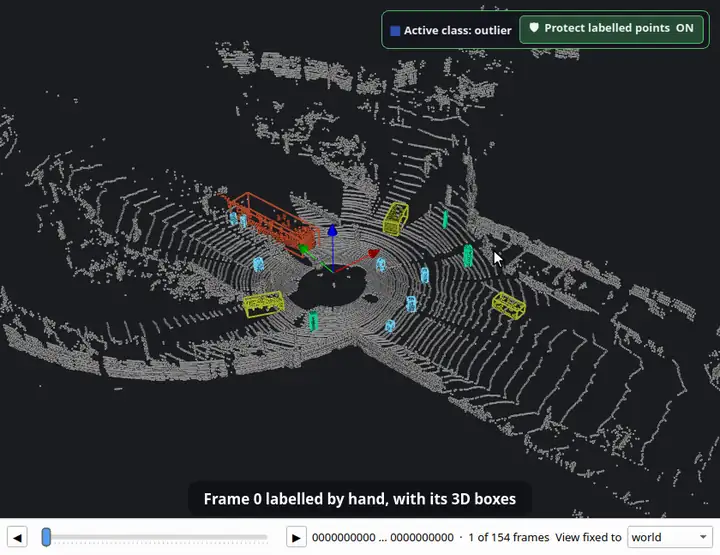

<p align="center">
  <picture>
    <source media="(prefers-color-scheme: dark)" srcset="docs/logo-dark.svg">
    
  </picture>
</p>

<p align="center">
  <b>English</b> · <a href="README.ko.md">한국어</a> · <a href="README.ja.md">日本語</a> · <a href="README.zh.md">简体中文</a> · <a href="README.de.md">Deutsch</a> · <a href="README.es.md">Español</a>
</p>

**A barbershop for robot maps.** Clean and edit OctoMap voxel maps, point clouds and ROS 2D occupancy grids — and, since 1.1, label LiDAR point clouds and scan sequences. Everything runs offline, in one window.

[](https://github.com/Hyounjun-Oh/MapBarber/actions/workflows/tests.yml)


## New in 1.1: LiDAR labelling

### Point cloud labelling
Classes, label brush, protection of labelled points, review tools, objects, and export to SemanticKITTI, KITTI and OpenPCDet.


### Smart pick
One click takes a whole car, pedestrian or pole without the ground under it — or a whole plane.


### 3D bounding boxes
Split a class into objects and box each one; a few mislabelled points do not stretch a box.


### Auto 3D box tracking
Follow the boxes forwards or backwards in time through a whole drive. Here: tracked from one hand-labelled frame through all 154 scans.



<sub>Labelling animations: [KITTI raw dataset](https://www.cvlibs.net/datasets/kitti/raw_data.php), drive 2011_09_26_0005 (Geiger et al., CC BY-NC-SA 3.0), frame 0 labelled by hand.</sub>

## Editors

| Voxel maps | Point clouds | 2D occupancy grids |
|---|---|---|
|  |  |  |
| OctoMap `.bt` / `.ot`: erase, add, islands, box, slice, ruler | PCD, PLY, LAS/LAZ, text, `.bin`: noise filters, thinning, colour by field | map_server YAML + PGM/PNG: pen, line, fill, speckles, trim |

Maps convert between the three kinds without loss, and every edit can be undone until you save.

## Quick start

```bash
git clone https://github.com/Hyounjun-Oh/MapBarber.git
cd MapBarber
./mapbarber.sh                                  # empty window — drop maps onto it
./mapbarber.sh demo/office_octomap.bt           # or open files, one tab each
```

The first run installs NumPy, SciPy, VTK and PySide6 into `.venv/` (about 500 MB); you need Python 3.10+ and a desktop session. `pip install .` works too (`pip install ".[las]"` adds LAS/LAZ). [`demo/`](demo/README.md) has realistic maps with known defects and a checklist.

## Documentation

The **[wiki](https://github.com/Hyounjun-Oh/MapBarber/wiki)** is the full guide: [Getting started](https://github.com/Hyounjun-Oh/MapBarber/wiki/Getting-Started) · [Labelling](https://github.com/Hyounjun-Oh/MapBarber/wiki/Labelling) · [Smart pick](https://github.com/Hyounjun-Oh/MapBarber/wiki/Smart-Pick) · [3D boxes](https://github.com/Hyounjun-Oh/MapBarber/wiki/3D-Boxes) · [Auto 3D box tracking](https://github.com/Hyounjun-Oh/MapBarber/wiki/Auto-3D-Box-Tracking) · [Frame sequences](https://github.com/Hyounjun-Oh/MapBarber/wiki/Frame-Sequences) · [Keyboard shortcuts](https://github.com/Hyounjun-Oh/MapBarber/wiki/Keyboard-Shortcuts) · [Files and formats](https://github.com/Hyounjun-Oh/MapBarber/wiki/Files-and-Formats) · [Command line](https://github.com/Hyounjun-Oh/MapBarber/wiki/Command-Line) · [FAQ](https://github.com/Hyounjun-Oh/MapBarber/wiki/FAQ) — also in [한국어](https://github.com/Hyounjun-Oh/MapBarber/wiki/Home-ko).

## License

[MIT](LICENSE) — free to use, modify and redistribute, including commercially. Dependencies keep their own licenses (PySide6 LGPL-3.0; VTK, NumPy, SciPy BSD-3-Clause); see [THIRD_PARTY_NOTICES.md](THIRD_PARTY_NOTICES.md), which also covers the KITTI data shown in the labelling animations. [CHANGELOG](CHANGELOG.md) · [Contributing](CONTRIBUTING.md) · [Security](SECURITY.md)
