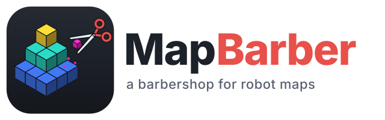
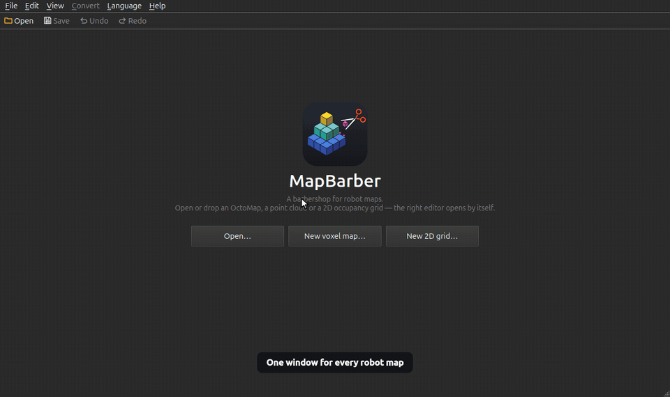
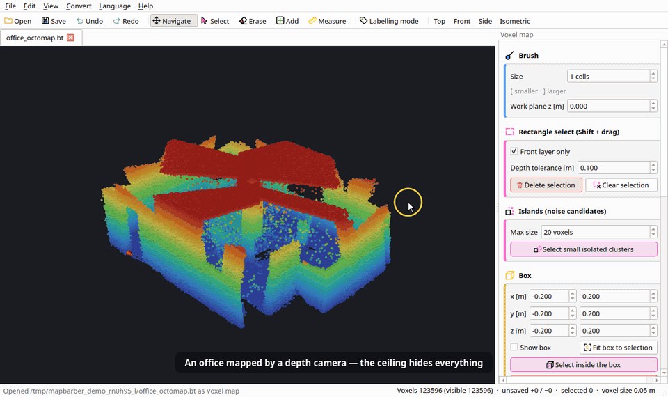
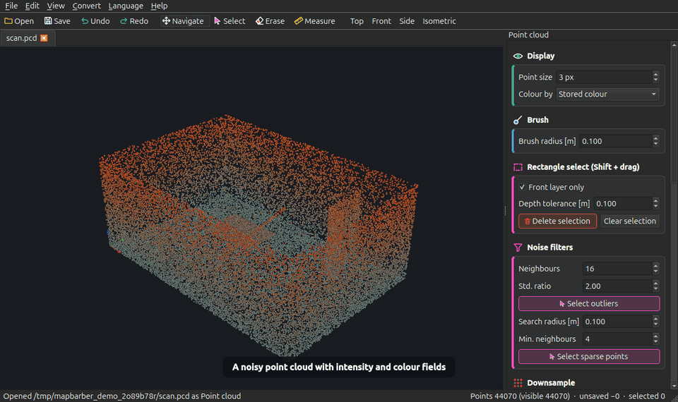
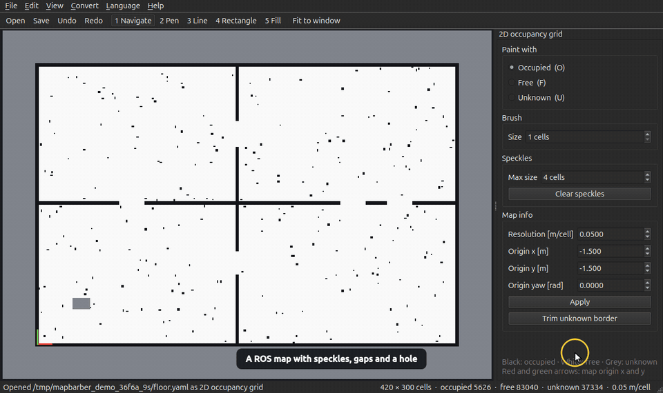

<p align="center">
  <picture>
    <source media="(prefers-color-scheme: dark)" srcset="docs/logo-dark.svg">
    
  </picture>
</p>

<p align="center">
  <b>English</b> · <a href="README.ko.md">한국어</a> · <a href="README.ja.md">日本語</a> · <a href="README.zh.md">简体中文</a> · <a href="README.de.md">Deutsch</a> · <a href="README.es.md">Español</a>
</p>

**A barbershop for robot maps.** Trim the stray voxels, points and pixels that noisy sensors leave behind, and fill the bald spots — in OctoMap octrees, point clouds and ROS 2D occupancy grids, all from one window.

[](https://github.com/Hyounjun-Oh/mapbarber/actions/workflows/tests.yml)




Open or drop files and MapBarber recognises what each one holds, then opens it in its own tab with the matching editor: a voxel editor for octrees, a point editor for clouds, and a painter for 2D occupancy grids. Maps can be converted between the three, and every edit is undoable until you save.

## Quick start

```bash
git clone https://github.com/Hyounjun-Oh/mapbarber.git
cd mapbarber
./mapbarber.sh                                      # empty window — drop maps onto it
./mapbarber.sh demo/office_octomap.bt demo/warehouse_map.yaml   # or open files, one tab each
```

The first run creates a private virtual environment in `.venv/` and installs NumPy, SciPy, VTK and PySide6 (about 500 MB). Later runs start immediately. You need Python 3.10 or newer and a desktop session (X11, or Wayland through XWayland, which the script selects for you).

Prefer pip? `pip install .` installs a `mapbarber` command that does the same thing.

**Try it on realistic data:** [`demo/`](demo/README.md) holds maps made from simulated sensors, each with known defects and known true dimensions, plus a step-by-step checklist.

## What it opens

| Map type | Files | Opens in |
|---|---|---|
| Voxel map | OctoMap `.bt` (binary), `.ot` (`OcTree`, `OcTreeStamped`, `ColorOcTree`), `.npz` voxel archives | voxel editor |
| Point cloud | `.pcd` (ascii, binary, organized), `.ply` (ascii, binary), `.xyz` / `.txt` / `.csv` (optional RGB columns), `.npy`, `.npz` | point cloud editor |
| 2D occupancy grid | map_server `.yaml` with `.pgm` / `.png` / `.bmp`, or the bare image | grid editor |

Detection looks at the extension first and the file signature second, so a backup such as `map.bt.bak_20240101` still opens as an octree. Opening a bare `.pgm` picks up the `.yaml` next to it when that YAML points at the image. Damaged or unrelated files are refused with a short reason.

## Voxel map editor



- **Tools:** Navigate `H`, Select `V`, Erase `E`, Add `B`, Measure `I`. The brush is a cube of 1–31 cells; `[` and `]` change its size. Add grows a layer outward from the face you click, or places voxels on a horizontal work plane.
- **Selection:** `Shift`-drag selects inside a screen rectangle (*Front layer only* skips hidden voxels). Right-click deselects under the cursor; `Shift`+right-drag deselects a rectangle.
- **Select islands** finds groups of voxels that touch nothing else — the floating specks depth cameras produce. It only selects, so you can look before pressing `Delete`.
- **Box:** drag the coloured arrows in the 3D view to move it along x, y or z, and the dots on its faces to resize it (or type the bounds). Then select, erase or fill everything inside.
- **Slice:** cut the space with a plane on x, y or z and work on one side; the other side is hidden and protected. Drag the plane's arrow, flip sides, and *Restore view* when done.
- **Ruler:** click two voxels to read the distance, Δx/Δy/Δz and the length in voxels. Hold `Shift` to lock the measurement to an axis; tick *Snap to voxel centres* for centre-to-centre readings. The voxel under the cursor is outlined, and the offsets along x, y and z are drawn as coloured legs with their values. A read-out in the top-right corner repeats each measurement as a clear diagram, keeps every measurement in its own tab, and sums them on the Σ tab.
- Voxels added since the last save are drawn white; the selection is pink.
- Panel sections carry an icon and a colour stripe, and buttons are tinted by purpose: red erases, green adds, pink selects.

## Point cloud editor



- **Tools:** Navigate `H`, Select `V`, Erase `E`, Measure `I`, with a spherical brush around the point you click (`[` / `]` change its radius), rectangle selection and right-click deselect.
- **Noise filters** select statistical outliers (mean neighbour distance far above the norm) or sparse points (too few neighbours within a radius).
- **Thin out** keeps one point per cubic cell. **Box** and **Slice** work as in the voxel editor, and the box can also erase everything outside.
- **Colour by** height, stored RGB or any numeric field such as `intensity` or `ring`.
- **Ruler** measures the real distance between two picked points.
- Points are only ever removed, so saving to PCD or PLY keeps every field of every surviving point.

## 2D occupancy grid editor



- **Tools:** Navigate `H`, Pen `B`, Line `L`, Rectangle `R`, Fill `G`, Measure `I`. Paint *occupied*, *free* or *unknown* with `O`, `F`, `U`; `[` / `]` change the pen width.
- **Constraints, as in PowerPoint:** hold `Shift` to lock a line (or the ruler) to 0°, 45° or 90° and to make a rectangle square; `Alt` draws a rectangle from its centre; `Shift`+click with the pen draws a straight line from the last point.
- **Clear speckles** frees small isolated occupied blobs.
- **Trim unknown border** crops the unexplored margin and moves the origin so nothing on the map shifts.
- **Map info** edits resolution and origin (x, y, yaw). The red and green arrows mark the map origin.
- **Ruler** gives the distance in metres and in pixels, and Δx/Δy in the map frame (rotated origins included).
- Zoomed out, thin walls stay visible: occupied cells win over unknown, unknown over free.
- Saving writes the image and a map_server YAML side by side (`trinary`, `scale` and `raw` modes, `negate`).

## Several maps at once

Every file opens in its own tab, and opening a file that is already open switches to it. `Ctrl+Tab` / `Ctrl+Shift+Tab` move between tabs, `Ctrl+W` closes one (asking first if it has unsaved changes), and you can drop several files at once.

The **Convert** menu turns the current map into another kind in a new tab, leaving the original untouched:

| From \ To | Voxel map | Point cloud | 2D grid |
|---|---|---|---|
| Voxel map | — | voxel centres | project a height band |
| Point cloud | voxelize at a chosen size | — | voxelize, then project |
| 2D grid | extrude walls to a height | — | — |

## Command line

Without `--output` or `--info` the editor opens. With them, nothing is shown and the work is done in the terminal:

```bash
./mapbarber.sh room.bt --info
./mapbarber.sh room.bt --remove-islands 20 -o room_clean.bt
./mapbarber.sh room.bt --z-band 0.1 1.8 -o floor.yaml          # octree -> ROS map
./mapbarber.sh floor.yaml --clear-speckles 4 -o floor_clean.yaml
./mapbarber.sh floor.yaml --wall-height 2.0 -o walls.bt        # ROS map -> octree
./mapbarber.sh scan.pcd --remove-outliers 16 2.0 -o scan_clean.pcd
./mapbarber.sh scan.pcd -r 0.05 -o scan.bt                     # cloud -> octree
```

The output extension decides the output type.

## Keyboard shortcuts

Shortcuts follow common desktop conventions (Photoshop, Figma and PowerPoint for tools and constraints, the operating system for files and editing). On macOS, `Ctrl` is `⌘`.

| Keys | Action |
|---|---|
| `Ctrl+O` / `Ctrl+S` / `Ctrl+Shift+S` | open / save / save as or export |
| `Ctrl+N` / `Ctrl+Shift+N` | new voxel map / new 2D grid |
| `Ctrl+W` / `Ctrl+Tab` / `Ctrl+Shift+Tab` | close tab / next tab / previous tab |
| `Ctrl+Z` / `Ctrl+Shift+Z` or `Ctrl+Y` | undo / redo |
| `H` `V` `E` `B` `L` `R` `G` `I` | navigate, select, erase, add/pen, line, rectangle, fill, measure |
| `[` / `]` | smaller / larger brush |
| `Delete` or `Backspace` | erase selection |
| `Ctrl+A` / `Ctrl+Shift+I` / `Esc` or `Ctrl+D` | select all visible / invert / deselect |
| Left drag / middle drag or `Space`+drag / wheel | rotate / pan / zoom (2D: left drag pans with Navigate) |
| `Shift`+drag / `Shift`+right drag / right click | rectangle select / rectangle deselect / deselect |
| `Shift` / `Alt` while drawing | lock to 0°·45°·90° or square / draw from the centre |
| `1` `3` `7` / `0` or `Home` | front, side, top / isometric view (numpad too) |
| `Ctrl+=` / `Ctrl+-` / `Ctrl+0` | zoom in / zoom out / fit (2D) |
| `F11` / `F1` | full screen / controls for the current editor |

## Languages

The interface speaks English, 한국어, 日本語, 简体中文, Deutsch and Español, switchable from the **Language** menu; the choice is remembered. To add a language, copy `mapbarber/locales/en.json`, translate the values, add the code to `LANGUAGES` in `mapbarber/i18n.py`, and run the tests — they check that every key and placeholder is present.

## File notes

- **Octree output** stores occupied cells only. Free-space information present in a source file is not written back, which matches how static maps are normally used for collision checking.
- **`.ot` output** uses one log-odds value (3.5, p ≈ 0.97) for every occupied cell.
- **PCD / PLY** keep all per-point fields. Organized PCDs open with invalid (NaN) points skipped and are saved unorganized. `.xyz`, `.csv` and `.npy` hold coordinates only, except that `.xyz` keeps RGB columns when you save to PCD or PLY. Compressed binary PCD is not supported.
- **Grids** follow the map_server rules: `trinary`, `scale` and `raw` modes, `negate`, and the occupied/free thresholds stored in the YAML.
- **Backups:** overwriting a file keeps the previous one as `name.bak_YYYYmmdd_HHMMSS`. Turn this off in the File menu.

## How it works

MapBarber is an independent implementation written from the published file layouts. It does not use or derive from the source code of OctoMap, PCL or map_server.

- Octree files are read and written as a *linear octree*. Occupied cells form a sorted array of Morton codes, so every tree node is a contiguous slice of that array, found by binary search. No pointer tree is built.
- Editing works on a sorted array of packed cell keys, with set operations for undo and redo.
- Connected components (islands, speckles) and neighbour queries use SciPy. Rendering uses VTK glyphs inside a Qt window.

## Development

```bash
python -m venv .venv && .venv/bin/pip install -e ".[dev]"
.venv/bin/pytest                                   # core tests, no display needed
MAPBARBER_GUI_TESTS=1 .venv/bin/pytest            # plus end-to-end tests in a real window
.venv/bin/python tools/make_examples.py            # regenerate examples/
.venv/bin/python tools/make_demo.py                # regenerate demo/ (add --large for performance files)
.venv/bin/python tools/record_demo.py docs         # re-record the animations (needs ffmpeg)
.venv/bin/python tools/make_logo.py                # regenerate the icon and logos
```

Set `MAPBARBER_QT` to `PySide6`, `PySide2` or `PyQt5` to choose a Qt binding.

## License

[MIT](LICENSE). Use, modify and redistribute it freely, including commercially; just keep the copyright notice and license text with any copy. This covers the code, translations, logo, icons and the example and demo maps, all made for this project.

The libraries it runs on keep their own licenses: PySide6 (LGPL-3.0), VTK, NumPy and SciPy (BSD-3-Clause). Running from source or installing with pip needs nothing more; if you redistribute a bundle that contains them, see [THIRD_PARTY_NOTICES.md](THIRD_PARTY_NOTICES.md). Contributions are accepted under the same license ([CONTRIBUTING.md](CONTRIBUTING.md)).
