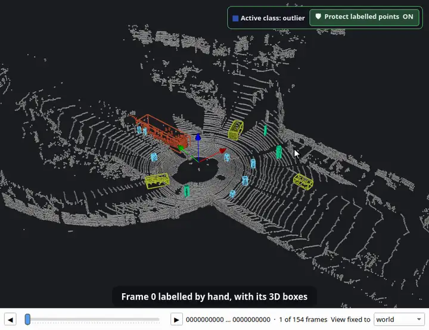

<p align="center">
  <picture>
    <source media="(prefers-color-scheme: dark)" srcset="docs/logo-dark.svg">
    
  </picture>
</p>

<p align="center">
  <a href="README.md">English</a> · <a href="README.ko.md">한국어</a> · <a href="README.ja.md">日本語</a> · <b>简体中文</b> · <a href="README.de.md">Deutsch</a> · <a href="README.es.md">Español</a>
</p>

**机器人地图的理发店。** 清理和编辑 OctoMap 体素地图、点云和 ROS 二维占据栅格；从 1.1 起还能标注 LiDAR 点云和扫描序列。全部离线，在一个窗口中完成。

[](https://github.com/Hyounjun-Oh/MapBarber/actions/workflows/tests.yml)


## 1.1 新功能：LiDAR 标注

### 点云标注
类别、标注画笔、已标注点保护、检查工具、物体，以及导出为 SemanticKITTI、KITTI 和 OpenPCDet 格式。


### 智能选取
点击一次即可选中整辆车、行人或杆子而不带地面，或选中整个平面。


### 3D 包围盒
把类别拆分为物体并为每个物体生成包围盒；少数标错的点不会撑大包围盒。


### 自动 3D 包围盒跟踪
按时间顺序或倒序在整段行驶中跟踪包围盒。示例：从一帧手动标注跟踪到全部 154 帧扫描。



<sub>标注动画：[KITTI raw dataset](https://www.cvlibs.net/datasets/kitti/raw_data.php)，行驶 2011_09_26_0005 (Geiger et al., CC BY-NC-SA 3.0)，第 0 帧为手动标注。</sub>

## 编辑器

| 体素地图 | 点云 | 二维占据栅格 |
|---|---|---|
|  |  |  |
| OctoMap `.bt` / `.ot`：擦除、添加、孤立块、包围框、切片、尺子 | PCD、PLY、LAS/LAZ、文本、`.bin`：噪声过滤、抽稀、按字段着色 | map_server YAML + PGM/PNG：画笔、直线、填充、去斑点、裁剪边缘 |

三种地图之间可无损转换，保存前的所有编辑都可撤销。

## 快速开始

```bash
git clone https://github.com/Hyounjun-Oh/MapBarber.git
cd MapBarber
./mapbarber.sh                                  # 空窗口 — 把地图拖进来
./mapbarber.sh demo/office_octomap.bt           # 或直接打开文件（每个文件一个标签页）
```

首次运行会在 `.venv/` 中安装 NumPy、SciPy、VTK 和 PySide6（约 500 MB）；需要 Python 3.10+ 和桌面环境。也可以 `pip install .`（`pip install ".[las]"` 增加 LAS/LAZ 支持）。[`demo/`](demo/README.md) 提供带已知缺陷的地图和检查清单。

## 文档

完整指南见 **[Wiki](https://github.com/Hyounjun-Oh/MapBarber/wiki)**（英文、韩文）： [入门](https://github.com/Hyounjun-Oh/MapBarber/wiki/Getting-Started) · [标注](https://github.com/Hyounjun-Oh/MapBarber/wiki/Labelling) · [智能选取](https://github.com/Hyounjun-Oh/MapBarber/wiki/Smart-Pick) · [3D 包围盒](https://github.com/Hyounjun-Oh/MapBarber/wiki/3D-Boxes) · [自动 3D 包围盒跟踪](https://github.com/Hyounjun-Oh/MapBarber/wiki/Auto-3D-Box-Tracking) · [帧序列](https://github.com/Hyounjun-Oh/MapBarber/wiki/Frame-Sequences) · [快捷键](https://github.com/Hyounjun-Oh/MapBarber/wiki/Keyboard-Shortcuts) · [文件格式](https://github.com/Hyounjun-Oh/MapBarber/wiki/Files-and-Formats) · [命令行](https://github.com/Hyounjun-Oh/MapBarber/wiki/Command-Line) · [FAQ](https://github.com/Hyounjun-Oh/MapBarber/wiki/FAQ)

## 许可证

[MIT](LICENSE) — 可自由使用、修改和再分发，包括商业用途。依赖库遵循各自的许可证（PySide6 LGPL-3.0；VTK、NumPy、SciPy BSD-3-Clause），包括标注动画中使用的 KITTI 数据，详见 [THIRD_PARTY_NOTICES.md](THIRD_PARTY_NOTICES.md)。[更新日志](CHANGELOG.md) · [贡献](CONTRIBUTING.md) · [安全](SECURITY.md)
