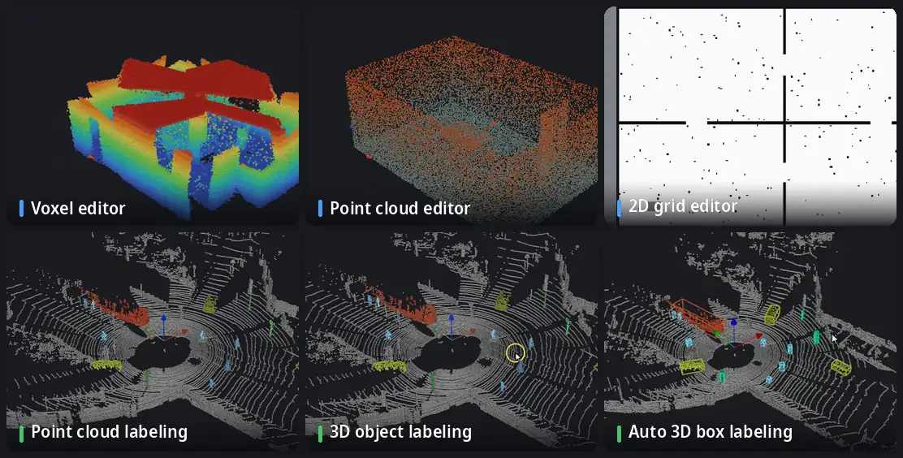

<p align="center">
  <picture>
    <source media="(prefers-color-scheme: dark)" srcset="../media/logo-dark.svg">
    
  </picture>
</p>

<p align="center">
  <a href="../../README.md">English</a> · <a href="README.ko.md">한국어</a> · <a href="README.ja.md">日本語</a> · <a href="README.zh.md">简体中文</a> · <b>Deutsch</b> · <a href="README.es.md">Español</a>
</p>

**Ein Friseursalon für Roboterkarten.** Bereinigen und bearbeiten Sie OctoMap-Voxelkarten, Punktwolken und ROS-2D-Belegungsraster — und seit 1.1 auch Punktwolken und LiDAR-Scan-Sequenzen beschriften. Alles läuft offline in einem Fenster.

[](https://github.com/Hyounjun-Oh/MapBarber/actions/workflows/tests.yml)


## Funktionen



<sub>LiDAR-Szenen: [KITTI raw dataset](https://www.cvlibs.net/datasets/kitti/raw_data.php), Fahrt 2011_09_26_0005 (Geiger et al., CC BY-NC-SA 3.0), Frame 0 von Hand beschriftet.</sub>

- **Voxel-Editor** — OctoMap `.bt` / `.ot`: radieren, hinzufügen, schwebende Inseln, Quader, Schnitt, Lineal; 35 Millionen Voxel bleiben flüssig.
- **Punktwolken-Editor** — PCD, PLY, LAS/LAZ, Text, `.bin`: Rauschfilter, Ausdünnen, Färben nach jedem Feld; beim Speichern bleibt jedes Feld erhalten.
- **2D-Raster-Editor** — ROS-map_server-Karten: Stift, Linie, Rechteck, Füllen, Sprenkel, Rand zuschneiden, Ursprung.
- **Punktwolken-Beschriftung** — Klassen, Beschriftungspinsel, intelligente Auswahl (ein Klick pro Objekt, Ebene oder Fläche), Schutz beschrifteter Punkte, Prüfwerkzeuge.
- **3D-Objekt-Beschriftung** — eine Klasse in Objekte teilen und jedem einen aufrechten 3D-Quader geben; wenige falsch beschriftete Punkte dehnen keinen Quader.
- **Automatische 3D-Quader-Beschriftung** — Quader und Punktlabels werden in einer Scan-Sequenz vorwärts oder rückwärts in der Zeit weitergetragen.

Außerdem: verlustfreie **Umwandlung** zwischen den drei Kartenarten, **Benchmark-Export** (SemanticKITTI, KITTI object und tracking, OpenPCDet) und eine **Kommandozeile** für Stapelarbeit.

Ausführliche Anleitung, alle Tastenkürzel und die Hinweise zu Dateien stehen im **[Wiki](https://github.com/Hyounjun-Oh/MapBarber/wiki)**.

## Schnellstart

```bash
git clone https://github.com/Hyounjun-Oh/MapBarber.git
cd MapBarber
./mapbarber.sh                                  # leeres Fenster — Karten hineinziehen
./mapbarber.sh demo/office_octomap.bt           # oder Dateien öffnen, je ein Tab
```

Der erste Start installiert NumPy, SciPy, VTK und PySide6 in `.venv/` (etwa 500 MB); nötig sind Python 3.10+ und eine Desktop-Sitzung. `pip install .` geht auch (`pip install ".[las]"` ergänzt LAS/LAZ). [`demo/`](../../demo/README.md) enthält realistische Karten mit bekannten Fehlern und eine Checkliste.

## Neu in 1.1

- **Punktwolken-Beschriftung** für einzelne Wolken, Scan-Sequenzen und Voxelkarten
- **Intelligente Auswahl**: ein ganzes Auto, ein Fußgänger oder ein Mast ohne Boden, oder eine ganze Ebene, mit einem Klick
- **3D-Objekt-Beschriftung** mit robuster Quader-Anpassung
- **Automatische 3D-Quader-Beschriftung** vorwärts oder rückwärts in der Zeit
- **Frame-Sequenzen**: KITTI- und Posen-Ordner, Zeitleiste, Labels zwischen Frames
- **Benchmark-Export**: SemanticKITTI, KITTI object und tracking, OpenPCDet

Alles Weitere im [Änderungsprotokoll](../CHANGELOG.md).

## Dokumentation

Die vollständige Anleitung steht im **[Wiki](https://github.com/Hyounjun-Oh/MapBarber/wiki)** (Englisch, Koreanisch): [Erste Schritte](https://github.com/Hyounjun-Oh/MapBarber/wiki/Getting-Started) · [Punktwolken-Beschriftung](https://github.com/Hyounjun-Oh/MapBarber/wiki/Labeling) · [Intelligente Auswahl](https://github.com/Hyounjun-Oh/MapBarber/wiki/Smart-Pick) · [3D-Objekt-Beschriftung](https://github.com/Hyounjun-Oh/MapBarber/wiki/3D-Boxes) · [3D-Quader-Beschriftung](https://github.com/Hyounjun-Oh/MapBarber/wiki/Auto-3D-Box-Labeling) · [Benchmark-Export](https://github.com/Hyounjun-Oh/MapBarber/wiki/Benchmark-Export) · [Frame-Sequenzen](https://github.com/Hyounjun-Oh/MapBarber/wiki/Frame-Sequences) · [Tastenkürzel](https://github.com/Hyounjun-Oh/MapBarber/wiki/Keyboard-Shortcuts) · [Dateien und Formate](https://github.com/Hyounjun-Oh/MapBarber/wiki/Files-and-Formats) · [Kommandozeile](https://github.com/Hyounjun-Oh/MapBarber/wiki/Command-Line) · [FAQ](https://github.com/Hyounjun-Oh/MapBarber/wiki/FAQ)

## Lizenz

[MIT](../../LICENSE) — frei nutzbar, änderbar und weitergebbar, auch kommerziell. Abhängigkeiten behalten ihre eigenen Lizenzen (PySide6 LGPL-3.0; VTK, NumPy, SciPy BSD-3-Clause); siehe [THIRD_PARTY_NOTICES.md](../THIRD_PARTY_NOTICES.md), auch zu den KITTI-Daten in den Animationen. [Änderungen](../CHANGELOG.md) · [Mitwirken](../../.github/CONTRIBUTING.md) · [Sicherheit](../../.github/SECURITY.md)
