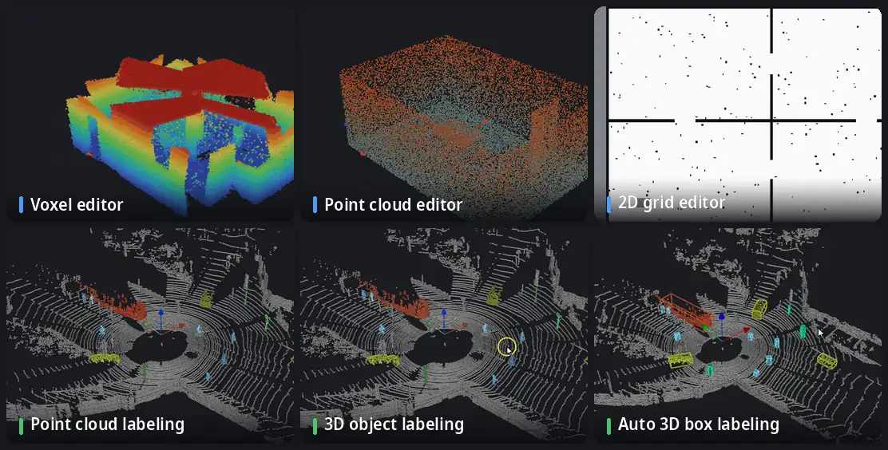

<p align="center">
  <picture>
    <source media="(prefers-color-scheme: dark)" srcset="../media/logo-dark.svg">
    
  </picture>
</p>

<p align="center">
  <a href="../../README.md">English</a> · <a href="README.ko.md">한국어</a> · <a href="README.ja.md">日本語</a> · <a href="README.zh.md">简体中文</a> · <a href="README.de.md">Deutsch</a> · <b>Español</b>
</p>

**Una barbería para mapas de robots.** Limpia y edita mapas de vóxeles OctoMap, nubes de puntos y rejillas de ocupación 2D de ROS — y, desde la 1.1, etiqueta nubes de puntos y secuencias de escaneos LiDAR. Todo funciona sin conexión, en una sola ventana.

[](https://github.com/Hyounjun-Oh/MapBarber/actions/workflows/tests.yml)


## Funciones



<sub>Escenas LiDAR: [KITTI raw dataset](https://www.cvlibs.net/datasets/kitti/raw_data.php), trayecto 2011_09_26_0005 (Geiger et al., CC BY-NC-SA 3.0), fotograma 0 etiquetado a mano.</sub>

- **Editor de vóxeles** — OctoMap `.bt` / `.ot`: borrar, añadir, islas flotantes, caja, corte, regla; 35 millones de vóxeles siguen fluidos.
- **Editor de nubes de puntos** — PCD, PLY, LAS/LAZ, texto, `.bin`: filtros de ruido, aclarado, color por cualquier campo; al guardar se conserva cada campo.
- **Editor de rejillas 2D** — mapas de map_server de ROS: lápiz, línea, rectángulo, relleno, motas, recorte del borde, origen.
- **Etiquetado de nubes de puntos** — clases, pincel de etiquetas, selección inteligente (un clic por objeto, plano o superficie), protección de puntos etiquetados, herramientas de revisión.
- **Etiquetado de objetos 3D** — divide una clase en objetos y da a cada uno una caja 3D vertical; unos pocos puntos mal etiquetados no estiran la caja.
- **Etiquetado automático de cajas 3D** — las cajas y las etiquetas de puntos se llevan hacia delante o hacia atrás en el tiempo por una secuencia de escaneos.

Además: **conversión** sin pérdidas entre los tres tipos de mapa, **exportación a benchmarks** (SemanticKITTI, KITTI object y tracking, OpenPCDet) y una **línea de comandos** para trabajo por lotes.

El uso detallado, todos los atajos y las notas sobre archivos están en la **[wiki](https://github.com/Hyounjun-Oh/MapBarber/wiki)**.

## Inicio rápido

```bash
git clone https://github.com/Hyounjun-Oh/MapBarber.git
cd MapBarber
./mapbarber.sh                                  # ventana vacía — suelta mapas en ella
./mapbarber.sh demo/office_octomap.bt           # o abre archivos, una pestaña cada uno
```

La primera ejecución instala NumPy, SciPy, VTK y PySide6 en `.venv/` (unos 500 MB); hace falta Python 3.10+ y una sesión de escritorio. También funciona `pip install .` (`pip install ".[las]"` añade LAS/LAZ). [`demo/`](../../demo/README.md) tiene mapas realistas con defectos conocidos y una lista de comprobación.

## Novedades en 1.1

- **Etiquetado de nubes de puntos** para nubes sueltas, secuencias de escaneos y mapas de vóxeles
- **Selección inteligente**: un coche, un peatón o un poste entero sin el suelo, o un plano entero, con un clic
- **Etiquetado de objetos 3D** con ajuste robusto de cajas
- **Etiquetado automático de cajas 3D** hacia delante o hacia atrás en el tiempo
- **Secuencias**: carpetas KITTI y con poses, línea de tiempo, etiquetas entre fotogramas
- **Exportación a benchmarks**: SemanticKITTI, KITTI object y tracking, OpenPCDet

Todo en el [registro de cambios](../CHANGELOG.md).

## Documentación

La guía completa está en la **[wiki](https://github.com/Hyounjun-Oh/MapBarber/wiki)** (inglés, coreano): [Primeros pasos](https://github.com/Hyounjun-Oh/MapBarber/wiki/Getting-Started) · [Etiquetado de nubes de puntos](https://github.com/Hyounjun-Oh/MapBarber/wiki/Labeling) · [Selección inteligente](https://github.com/Hyounjun-Oh/MapBarber/wiki/Smart-Pick) · [Etiquetado de objetos 3D](https://github.com/Hyounjun-Oh/MapBarber/wiki/3D-Boxes) · [Etiquetado automático de cajas 3D](https://github.com/Hyounjun-Oh/MapBarber/wiki/Auto-3D-Box-Labeling) · [Exportación a benchmarks](https://github.com/Hyounjun-Oh/MapBarber/wiki/Benchmark-Export) · [Secuencias](https://github.com/Hyounjun-Oh/MapBarber/wiki/Frame-Sequences) · [Atajos de teclado](https://github.com/Hyounjun-Oh/MapBarber/wiki/Keyboard-Shortcuts) · [Archivos y formatos](https://github.com/Hyounjun-Oh/MapBarber/wiki/Files-and-Formats) · [Línea de comandos](https://github.com/Hyounjun-Oh/MapBarber/wiki/Command-Line) · [FAQ](https://github.com/Hyounjun-Oh/MapBarber/wiki/FAQ)

## Licencia

[MIT](../../LICENSE) — libre de usar, modificar y redistribuir, también comercialmente. Las dependencias mantienen sus propias licencias (PySide6 LGPL-3.0; VTK, NumPy, SciPy BSD-3-Clause); consulta [THIRD_PARTY_NOTICES.md](../THIRD_PARTY_NOTICES.md), que cubre también los datos de KITTI de las animaciones. [Cambios](../CHANGELOG.md) · [Contribuir](../../.github/CONTRIBUTING.md) · [Seguridad](../../.github/SECURITY.md)
