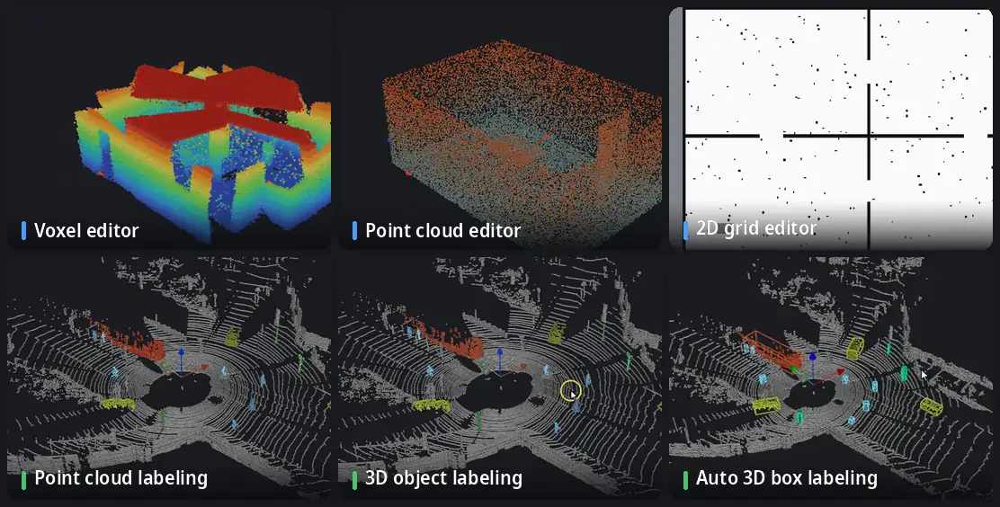

<p align="center">
  <picture>
    <source media="(prefers-color-scheme: dark)" srcset="../media/logo-dark.svg">
    
  </picture>
</p>

<p align="center">
  <a href="../../README.md">English</a> · <a href="README.ko.md">한국어</a> · <b>日本語</b> · <a href="README.zh.md">简体中文</a> · <a href="README.de.md">Deutsch</a> · <a href="README.es.md">Español</a>
</p>

**ロボット地図の床屋。** OctoMap のボクセル地図、点群、ROS の 2D 占有格子を整え、編集します。1.1 からは点群と LiDAR スキャン列のラベル付けもできます。すべてオフライン、ひとつのウィンドウで動きます。

[](https://github.com/Hyounjun-Oh/MapBarber/actions/workflows/tests.yml)


## 機能



<sub>LiDAR シーン: [KITTI raw dataset](https://www.cvlibs.net/datasets/kitti/raw_data.php)、走行 2011_09_26_0005 (Geiger et al., CC BY-NC-SA 3.0)、フレーム 0 は手でラベル付け。</sub>

- **ボクセルエディタ** — OctoMap `.bt` / `.ot`: 消去、追加、浮いた孤立クラスタ、ボックス、スライス、定規。3,500 万ボクセルでも操作できます。
- **点群エディタ** — PCD, PLY, LAS/LAZ, テキスト, `.bin`: ノイズフィルタ、間引き、フィールド別の色。保存してもすべてのフィールドが残ります。
- **2D 格子エディタ** — ROS map_server の地図: ペン、直線、四角形、塗りつぶし、ごみ取り、余白の切り取り、原点。
- **点群のラベル付け** — クラス、ラベルブラシ、スマート選択 (クリックひとつで物体・平面・面)、ラベル済み点の保護、確認ツール。
- **3D 物体のラベル付け** — クラスを物体に分け、物体ごとに直立した 3D ボックスを作ります。少数の誤ラベル点でボックスが伸びません。
- **自動 3D ボックスラベル付け** — ボックスと点のラベルをスキャン列の時間順・逆順に引き継ぎます。

ほかに: 3 種類の地図間の劣化のない**変換**、**ベンチマーク形式への書き出し** (SemanticKITTI、KITTI object・tracking、OpenPCDet)、一括処理用の**コマンドライン**。

詳しい使い方、すべてのショートカット、ファイルの注意点は **[Wiki](https://github.com/Hyounjun-Oh/MapBarber/wiki)** にあります。

## クイックスタート

```bash
git clone https://github.com/Hyounjun-Oh/MapBarber.git
cd MapBarber
./mapbarber.sh                                  # 空のウィンドウ — 地図をドロップ
./mapbarber.sh demo/office_octomap.bt           # またはファイルを開く (ファイルごとにタブ)
```

初回起動で `.venv/` に NumPy、SciPy、VTK、PySide6 を入れます (約 500 MB)。Python 3.10 以上とデスクトップ環境が必要です。`pip install .` でも使え、`pip install ".[las]"` で LAS/LAZ に対応します。[`demo/`](../../demo/README.md) に欠陥のわかっている地図とチェックリストがあります。

## 1.1 の新機能

- 単一の点群・スキャン列・ボクセル地図の**点群のラベル付け**
- **スマート選択**: クリックひとつで車・歩行者・ポールを地面なしで、あるいは平面全体を
- 頑健なボックス当てはめによる **3D 物体のラベル付け**
- 時間順・逆順の**自動 3D ボックスラベル付け**
- **フレーム列**: KITTI とポーズ付きフォルダ、タイムライン、フレーム間のラベル受け渡し
- **ベンチマーク形式への書き出し**: SemanticKITTI、KITTI object・tracking、OpenPCDet

詳しくは[変更履歴](../CHANGELOG.md)をご覧ください。

## ドキュメント

詳しい使い方は **[Wiki](https://github.com/Hyounjun-Oh/MapBarber/wiki)** (英語・韓国語) にあります: [はじめに](https://github.com/Hyounjun-Oh/MapBarber/wiki/Getting-Started) · [点群のラベル付け](https://github.com/Hyounjun-Oh/MapBarber/wiki/Labeling) · [スマート選択](https://github.com/Hyounjun-Oh/MapBarber/wiki/Smart-Pick) · [3D 物体のラベル付け](https://github.com/Hyounjun-Oh/MapBarber/wiki/3D-Boxes) · [自動 3D ボックスラベル付け](https://github.com/Hyounjun-Oh/MapBarber/wiki/Auto-3D-Box-Labeling) · [ベンチマーク書き出し](https://github.com/Hyounjun-Oh/MapBarber/wiki/Benchmark-Export) · [フレーム列](https://github.com/Hyounjun-Oh/MapBarber/wiki/Frame-Sequences) · [ショートカット](https://github.com/Hyounjun-Oh/MapBarber/wiki/Keyboard-Shortcuts) · [ファイル形式](https://github.com/Hyounjun-Oh/MapBarber/wiki/Files-and-Formats) · [コマンドライン](https://github.com/Hyounjun-Oh/MapBarber/wiki/Command-Line) · [FAQ](https://github.com/Hyounjun-Oh/MapBarber/wiki/FAQ)

## ライセンス

[MIT](../../LICENSE) — 商用を含め自由に使用・改変・再配布できます。依存ライブラリはそれぞれのライセンスに従います (PySide6 LGPL-3.0、VTK・NumPy・SciPy BSD-3-Clause)。アニメーションに使った KITTI データも含め [THIRD_PARTY_NOTICES.md](../THIRD_PARTY_NOTICES.md) をご覧ください。[変更履歴](../CHANGELOG.md) · [貢献](../../.github/CONTRIBUTING.md) · [セキュリティ](../../.github/SECURITY.md)
