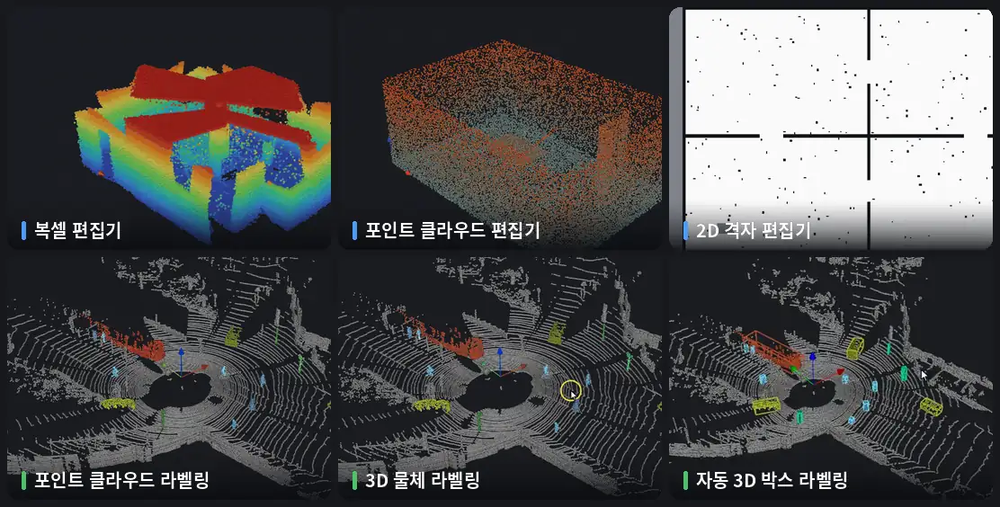

<p align="center">
  <picture>
    <source media="(prefers-color-scheme: dark)" srcset="../media/logo-dark.svg">
    
  </picture>
</p>

<p align="center">
  <a href="../../README.md">English</a> · <b>한국어</b> · <a href="README.ja.md">日本語</a> · <a href="README.zh.md">简体中文</a> · <a href="README.de.md">Deutsch</a> · <a href="README.es.md">Español</a>
</p>

**로봇 맵을 위한 이발소.** OctoMap 복셀 맵, 포인트 클라우드, ROS 2D 점유 격자를 정리하고 편집합니다. 1.1 부터는 포인트 클라우드와 LiDAR 스캔 시퀀스 라벨링도 됩니다. 모두 오프라인으로, 창 하나에서 동작합니다.

[](https://github.com/Hyounjun-Oh/MapBarber/actions/workflows/tests.yml)


## 기능



<sub>LiDAR 장면: [KITTI raw dataset](https://www.cvlibs.net/datasets/kitti/raw_data.php), 2011_09_26_0005 주행 (Geiger et al., CC BY-NC-SA 3.0), 0번 프레임은 직접 라벨링한 GT.</sub>

- **복셀 편집기** — OctoMap `.bt` / `.ot`: 지우기, 추가, 떠 있는 고립 덩어리, 상자, 슬라이스, 자. 3,500만 복셀도 조작할 수 있습니다.
- **포인트 클라우드 편집기** — PCD, PLY, LAS/LAZ, 텍스트, `.bin`: 잡음 필터, 솎아내기, 필드별 색. 저장해도 모든 필드가 유지됩니다.
- **2D 격자 편집기** — ROS map_server 맵: 펜, 직선, 사각형, 채우기, 잡티, 테두리 자르기, 원점.
- **포인트 클라우드 라벨링** — 클래스, 라벨 붓, 스마트 선택(클릭 한 번에 물체·평면·면), 라벨된 포인트 보호, 검수 도구.
- **3D 물체 라벨링** — 클래스를 물체로 나누고 물체마다 세워진 3D 박스를 만듭니다. 잘못 라벨된 소수의 점이 박스를 늘리지 않습니다.
- **자동 3D 박스 라벨링** — 박스와 포인트 라벨을 스캔 시퀀스에서 시간순·역순으로 이어 붙입니다.

그 밖에: 세 맵 종류 사이의 손실 없는 **변환**, **벤치마크 내보내기**(SemanticKITTI, KITTI object·tracking, OpenPCDet), 일괄 작업용 **명령행**.

자세한 사용법, 전체 단축키, 파일 참고 사항은 **[위키](https://github.com/Hyounjun-Oh/MapBarber/wiki/Home-ko)** 에 있습니다.

## 빠른 시작

```bash
git clone https://github.com/Hyounjun-Oh/MapBarber.git
cd MapBarber
./mapbarber.sh                                  # 빈 창 — 맵 파일을 끌어다 놓으세요
./mapbarber.sh demo/office_octomap.bt           # 또는 파일을 바로 열기 (파일마다 탭 하나)
```

처음 실행할 때 `.venv/` 에 NumPy, SciPy, VTK, PySide6 를 설치합니다(약 500 MB). Python 3.10 이상과 데스크톱 환경이 필요합니다. `pip install .` 도 되고, `pip install ".[las]"` 는 LAS/LAZ 지원을 더합니다. [`demo/`](../../demo/README.ko.md) 에 결함을 아는 실제 같은 맵과 점검표가 있습니다.

## 1.1 신규

- 단일 클라우드·스캔 시퀀스·복셀 맵의 **포인트 클라우드 라벨링**
- **스마트 선택**: 클릭 한 번에 차·보행자·기둥을 바닥 없이, 또는 평면 전체
- 견고한 박스 맞춤의 **3D 물체 라벨링**
- 시간순·역순 **자동 3D 박스 라벨링**
- **프레임 시퀀스**: KITTI·pose 폴더, 타임라인, 프레임 간 라벨 전달
- **벤치마크 내보내기**: SemanticKITTI, KITTI object·tracking, OpenPCDet

전체 내용은 [변경 내역](../CHANGELOG.md)에 있습니다.

## 문서

자세한 사용법은 **[위키](https://github.com/Hyounjun-Oh/MapBarber/wiki/Home-ko)** 에 있습니다: [시작하기](https://github.com/Hyounjun-Oh/MapBarber/wiki/Getting-Started-ko) · [포인트 클라우드 라벨링](https://github.com/Hyounjun-Oh/MapBarber/wiki/Labeling-ko) · [스마트 선택](https://github.com/Hyounjun-Oh/MapBarber/wiki/Smart-Pick-ko) · [3D 물체 라벨링](https://github.com/Hyounjun-Oh/MapBarber/wiki/3D-Boxes-ko) · [자동 3D 박스 라벨링](https://github.com/Hyounjun-Oh/MapBarber/wiki/Auto-3D-Box-Labeling-ko) · [벤치마크 내보내기](https://github.com/Hyounjun-Oh/MapBarber/wiki/Benchmark-Export-ko) · [프레임 시퀀스](https://github.com/Hyounjun-Oh/MapBarber/wiki/Frame-Sequences-ko) · [단축키](https://github.com/Hyounjun-Oh/MapBarber/wiki/Keyboard-Shortcuts-ko) · [파일 형식](https://github.com/Hyounjun-Oh/MapBarber/wiki/Files-and-Formats-ko) · [명령행](https://github.com/Hyounjun-Oh/MapBarber/wiki/Command-Line-ko) · [FAQ](https://github.com/Hyounjun-Oh/MapBarber/wiki/FAQ-ko) — [English](https://github.com/Hyounjun-Oh/MapBarber/wiki) 판도 있습니다.

## 라이선스

[MIT](../../LICENSE) — 상업적 용도를 포함해 자유롭게 사용·수정·재배포할 수 있습니다. 의존 라이브러리는 각자의 라이선스를 따릅니다(PySide6 LGPL-3.0, VTK·NumPy·SciPy BSD-3-Clause). 애니메이션에 쓴 KITTI 데이터를 포함해 [THIRD_PARTY_NOTICES.md](../THIRD_PARTY_NOTICES.md) 를 보세요. [변경 내역](../CHANGELOG.md) · [기여](../../.github/CONTRIBUTING.md) · [보안](../../.github/SECURITY.md)
