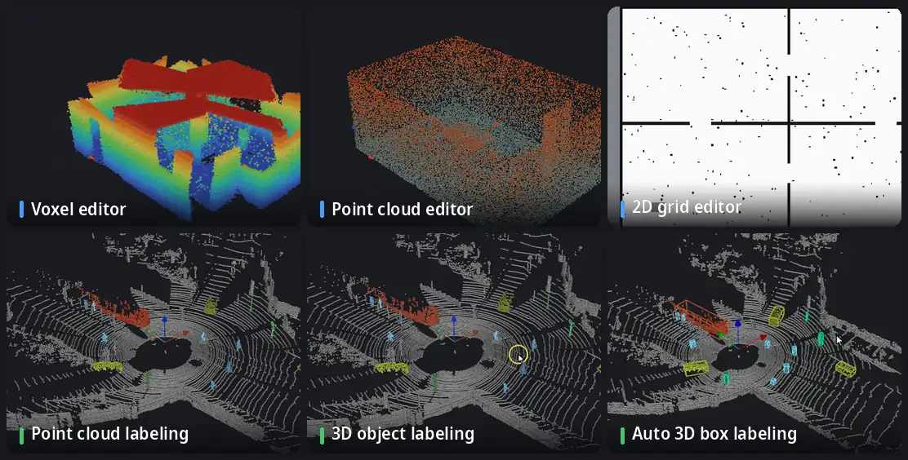

<p align="center">
  <picture>
    <source media="(prefers-color-scheme: dark)" srcset="../media/logo-dark.svg">
    
  </picture>
</p>

<p align="center">
  <a href="../../README.md">English</a> · <a href="README.ko.md">한국어</a> · <a href="README.ja.md">日本語</a> · <b>简体中文</b> · <a href="README.de.md">Deutsch</a> · <a href="README.es.md">Español</a>
</p>

**机器人地图的理发店。** 清理和编辑 OctoMap 体素地图、点云和 ROS 二维占据栅格；从 1.1 起还能标注点云和 LiDAR 扫描序列。全部离线，在一个窗口中完成。

[](https://github.com/Hyounjun-Oh/MapBarber/actions/workflows/tests.yml)


## 功能



<sub>LiDAR 场景：[KITTI raw dataset](https://www.cvlibs.net/datasets/kitti/raw_data.php)，行驶 2011_09_26_0005 (Geiger et al., CC BY-NC-SA 3.0)，第 0 帧为手动标注。</sub>

- **体素编辑器** — OctoMap `.bt` / `.ot`：擦除、添加、悬浮孤立块、包围框、切片、尺子；3500 万体素也能流畅操作。
- **点云编辑器** — PCD、PLY、LAS/LAZ、文本、`.bin`：噪声过滤、抽稀、按任意字段着色；保存时保留所有字段。
- **二维栅格编辑器** — ROS map_server 地图：画笔、直线、矩形、填充、去斑点、裁剪边缘、原点。
- **点云标注** — 类别、标注画笔、智能选取（点击一次选中物体、平面或曲面）、已标注点保护、检查工具。
- **3D 物体标注** — 把类别拆分为物体并为每个物体生成直立的 3D 框；少数标错的点不会撑大框。
- **自动 3D 包围盒标注** — 按时间顺序或倒序在扫描序列中延续包围盒和点标签。

此外：三种地图之间的无损**转换**、**基准格式导出**（SemanticKITTI、KITTI object 与 tracking、OpenPCDet）以及用于批处理的**命令行**。

详细用法、全部快捷键和文件说明见 **[Wiki](https://github.com/Hyounjun-Oh/MapBarber/wiki)**。

## 快速开始

```bash
git clone https://github.com/Hyounjun-Oh/MapBarber.git
cd MapBarber
./mapbarber.sh                                  # 空窗口 — 把地图拖进来
./mapbarber.sh demo/office_octomap.bt           # 或直接打开文件（每个文件一个标签页）
```

首次运行会在 `.venv/` 中安装 NumPy、SciPy、VTK 和 PySide6（约 500 MB）；需要 Python 3.10+ 和桌面环境。也可以 `pip install .`（`pip install ".[las]"` 增加 LAS/LAZ 支持）。[`demo/`](../../demo/README.md) 提供带已知缺陷的地图和检查清单。

## 1.1 新功能

- 适用于单个点云、扫描序列和体素地图的**点云标注**
- **智能选取**：点击一次选中整辆车、行人或杆子而不带地面，或整个平面
- 带稳健拟合的 **3D 物体标注**
- 按时间顺序或倒序的**自动 3D 包围盒标注**
- **帧序列**：KITTI 与带位姿的文件夹、时间轴、帧间传递标签
- **基准格式导出**：SemanticKITTI、KITTI object 与 tracking、OpenPCDet

完整内容见[更新日志](../CHANGELOG.md)。

## 文档

完整指南见 **[Wiki](https://github.com/Hyounjun-Oh/MapBarber/wiki)**（英文、韩文）： [入门](https://github.com/Hyounjun-Oh/MapBarber/wiki/Getting-Started) · [点云标注](https://github.com/Hyounjun-Oh/MapBarber/wiki/Labeling) · [智能选取](https://github.com/Hyounjun-Oh/MapBarber/wiki/Smart-Pick) · [3D 物体标注](https://github.com/Hyounjun-Oh/MapBarber/wiki/3D-Boxes) · [自动 3D 包围盒标注](https://github.com/Hyounjun-Oh/MapBarber/wiki/Auto-3D-Box-Labeling) · [基准格式导出](https://github.com/Hyounjun-Oh/MapBarber/wiki/Benchmark-Export) · [帧序列](https://github.com/Hyounjun-Oh/MapBarber/wiki/Frame-Sequences) · [快捷键](https://github.com/Hyounjun-Oh/MapBarber/wiki/Keyboard-Shortcuts) · [文件格式](https://github.com/Hyounjun-Oh/MapBarber/wiki/Files-and-Formats) · [命令行](https://github.com/Hyounjun-Oh/MapBarber/wiki/Command-Line) · [FAQ](https://github.com/Hyounjun-Oh/MapBarber/wiki/FAQ)

## 许可证

[MIT](../../LICENSE) — 可自由使用、修改和再分发，包括商业用途。依赖库遵循各自的许可证（PySide6 LGPL-3.0；VTK、NumPy、SciPy BSD-3-Clause），包括动画中使用的 KITTI 数据，详见 [THIRD_PARTY_NOTICES.md](../THIRD_PARTY_NOTICES.md)。[更新日志](../CHANGELOG.md) · [贡献](../../.github/CONTRIBUTING.md) · [安全](../../.github/SECURITY.md)
